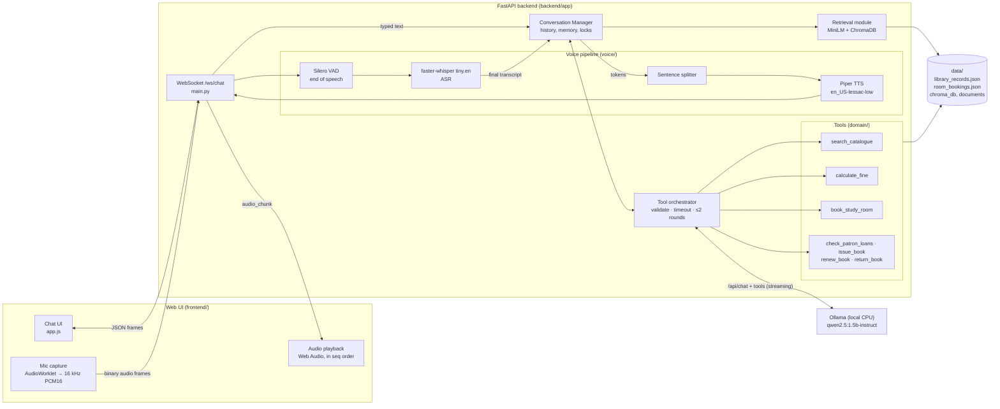

# NUCES Virtual Desk — OPAC FAST NUCES Library Assistant

A local, voice-enabled library assistant for the FAST NUCES library. Patrons can **type or speak** to the *NUCES Virtual Desk*. It answers from the library's own documents (RAG), and it can **act**: search the live catalogue, calculate overdue fines, book group study rooms, and issue / renew / return books. Everything runs **locally on a CPU laptop**: no cloud APIs, no browser speech APIs.

This repository is the final state of a three-part NLP course project:

| Assignment | What it added |
|---|---|
| 1 | Conversational library assistant: FastAPI + WebSocket token streaming, local Ollama LLM, per-session memory, persona and refusal rules, web chat UI |
| 2 | Retrieval-augmented generation over 80 library documents (MiniLM + ChromaDB), live JSON records database, first LLM tools (issue/renew/return/loans), citations, context-window budgeting |
| 3 | **Voice** (local streaming ASR with VAD, sentence-level streaming TTS), a **tool orchestrator** with three new tools, latency metrics, concurrency tests |

## Team

| Name | Roll number |
|---|---|
| Burhan Aslam | 23I-3097 |
| Saad Abdullah | 23I-3045 |

---

## 1. Business use case

**OPAC FAST NUCES** is the university library. Its desk staff answer the same questions all day: *Do you have this book? Where is it? When is it due? How much is my fine? Is a study room free?* The Virtual Desk answers these 24/7, by text or voice:

- **Catalogue**: availability, shelf location and due dates from the live catalogue (40 titles).
- **Policies and facilities**: loans, renewals, holds, fines, opening hours, rooms, printing, staff (80 documents).
- **Patron actions**: check loans, issue, renew and return books on a patron card (sample card `P-78421`).
- **Fines**: exact overdue fine per policy POL-002.
- **Study rooms**: availability and bookings for group rooms 301–306.

It politely refuses anything outside the library (jokes, homework, code, medical/legal advice).

Example dialogues (from Assignment 1, still valid):
- *"Do you have Speech and Language Processing?"* → title, Jurafsky & Martin, Stacks B / P98, available.
- *"Card P-78421 — what is due this week?"* → lists The Great Gatsby and Database System Concepts with due dates. *"Can I renew Gatsby?"* → renews it and states the new due date.
- *"Tell me a joke."* → declines and offers library help.

---

## 2. Architecture



**Voice is not a separate system.** A spoken turn becomes text at `transcript_final` and then goes through exactly the same function as a typed message (`_run_turn` → `ConversationManager.stream_reply`). It uses the same session history, retrieval, tools and LLM streaming. You can type one turn and speak the next in the same chat, and the assistant remembers both.

| Component | Path |
|---|---|
| API + WebSocket, turn runner | `backend/app/main.py` |
| Conversation manager (history, RAG, notes) | `backend/app/conversation/manager.py` |
| Tool orchestrator (LLM ↔ tools loop) | `backend/app/conversation/tool_orchestrator.py` |
| Tool registry (names, descriptions, schemas) | `backend/app/domain/tools.py` |
| Tools | `domain/records.py` (catalogue, loans), `domain/fines.py`, `domain/rooms.py` |
| Voice: VAD, endpointing, ASR, TTS, sentence splitter | `backend/app/voice/` |
| RAG indexer / retriever | `backend/app/rag/` |
| LLM client (Ollama) | `backend/app/llm/ollama.py` |
| Browser: chat, mic worklet, playback | `frontend/app.js`, `frontend/audio-worklet.js`, `frontend/voice.js` |

---

## 3. Model choices

| Role | Model | Why |
|---|---|---|
| LLM | **qwen2.5:1.5b-instruct** (Ollama, Q4, CPU) | We started with llama3.2:3b, and it is still selectable with `OLLAMA_MODEL`. On our laptop qwen2.5:1.5b was ~2.5× faster (11–14 vs 5–6 tok/s, first token 0.8 s vs 1.2–1.5 s when cached) and made the right tool decision 2/2 vs 0/2 for llama, which called a tool on almost every question. It supports Ollama native tool calling. See `docs/BENCHMARKS.md`. |
| ASR | **faster-whisper `tiny.en`**, int8, greedy | Local Whisper via CTranslate2. tiny.en transcribes a 3–7 s question in ~0.6–0.9 s on our CPU. `base.en` is about 2× slower and 2× larger to download (switch with `ASR_MODEL=base.en`). A short domain prompt helps it spell library terms. |
| VAD | **Silero VAD** (ONNX, onnxruntime) | Accurate neural VAD, 0.4 ms per 32 ms frame, ~2 MB. It runs frame by frame while audio streams, which is what end-of-speech detection needs. |
| TTS | **Piper `en_US-lessac-low`** | Fast local neural TTS: ~0.2–0.3 s to synthesise a sentence (≈16× faster than real time). The "low" (16 kHz) voice is the same download size as "medium" but cheaper to synthesise. |
| Embeddings | **all-MiniLM-L6-v2** (sentence-transformers) | Small (90 MB), fast on CPU (~15–40 ms per query), 384-d normalised vectors for cosine search. Stored locally in `models/`. |

All model files live in `models/` (gitignored) and are downloaded once by `scripts/download_models.py`. After that the system runs fully offline.

---

## 4. Document collection and retrieval (RAG)

- **Corpus**: 80 Markdown documents in `data/documents/`: 40 book records (`BK-*`), 10 policies (`POL-*`: borrowing, fines, holds, renewals, hours…), 10 FAQs, 5 facilities (`FAC-*`), 10 reading lists (`RL-*`), 5 staff profiles. Each has a small YAML-style header (doc_id, title, category, …).
- **Chunking**: paragraph-based, max 1,600 characters (~400 tokens) with 200-character overlap; long paragraphs split at sentence boundaries. With this corpus every document fits in one chunk (80 chunks).
- **Embeddings**: all-MiniLM-L6-v2, normalised.
- **Vector store**: ChromaDB `PersistentClient` at `data/chroma_db`, collection `library_v1`, cosine HNSW. Deterministic MD5 chunk IDs make re-indexing idempotent: `python -m backend.app.rag.indexer`.
- **Top-k**: `RAG_TOP_K=5`.
- **Confidence bands** on the top similarity: ≥ 0.60 high, 0.40–0.60 medium / medium-strong (gap to 2nd ≥ 0.10), 0.30–0.40 low, < 0.30 none (`RAG_SIMILARITY_THRESHOLD`). With "none" the model is told nothing relevant was found, and to use a tool if one fits, never to guess.
- **Context budget**: at most `RAG_MAX_CHARS=800` characters of retrieved text per turn. The best chunk is always kept and trimmed if needed. It was 2,000 in Assignment 2; we reduced it because every token costs latency on our CPU.
- **Caching and safety**: LRU cache of 256 queries (cache hit ≈ 0 ms); retrieval runs in a worker thread with a 5 s timeout, falling back to no-RAG on error.
- **Citations**: a `rag_sources` frame lists the documents used; the UI shows them under the answer.
- **Live data vs documents**: the documents are static, but the catalogue in `data/library_records.json` changes when books are issued or returned. The catalogue is built from the same 40 `BK-*` headers, so the two agree, and `search_catalogue` reads the live state.

---

## 5. Conversation memory and context budgeting

- Each chat has a `session_id`. The server keeps its message list (system prompt + user/assistant turns) in `ConversationManager`. The browser keeps a multi-chat list in `localStorage`; each chat maps to its own `session_id`.
- **Token budget**: history is trimmed newest-first to `MAX_CONTEXT_TOKENS=3072` (≈ 4 chars/token); the system prompt and any summary are always kept. At 95% the session is auto-summarised (or manually with the **Summarise** button); a context bar shows usage.
- **Per-turn context** is added only to the copy sent to the LLM, never stored: retrieved chunks, the user's name/card learned in this session, today's date, patron loan hints. These go at the **end of the last user message**, so the fixed prompt start (system prompt + tool schemas) stays identical and Ollama can reuse its cached computation. This change cut voice latency in half (see §9).
- `num_ctx=4096` for the LLM; replies capped at `OLLAMA_NUM_PREDICT=300` tokens.
- **Concurrency**: one `asyncio.Lock` per session (turns in one chat run in order; different chats run in parallel). Records and room bookings each have their own lock and atomic file writes.

---

## 6. WebSocket protocol — `ws://127.0.0.1:8000/ws/chat`

One connection per browser tab. Text frames are JSON; **binary frames are microphone audio**. The original text contract is **unchanged**; everything for Assignment 3 is additive, so an old client works exactly as before.

**Decision: one socket, not a separate `/ws/voice`.** Voice turns must share the session, history and turn lock with typed turns. Putting audio on the same socket reuses the same handler and `session_id`, with no second streaming loop to keep in sync. The only change needed was `receive()` instead of `receive_text()`, so binary frames are accepted.

### Original contract (Assignments 1–2, unchanged)

Client → server:
```json
{"type": "user_message", "session_id": "3f1c…", "content": "Do you have Clean Code?"}
{"type": "reset_session", "session_id": "3f1c…"}
{"type": "request_summarise", "session_id": "3f1c…"}
```
Server → client:
```json
{"type": "token", "session_id": "3f1c…", "content": "Yes, "}
{"type": "done", "session_id": "3f1c…"}
{"type": "error", "session_id": "3f1c…", "message": "Message cannot be empty or whitespace only."}
{"type": "session_reset", "session_id": "3f1c…"}
{"type": "rate_limit", "session_id": "3f1c…", "message": "Too many messages. Please wait a moment."}
{"type": "rag_sources", "session_id": "3f1c…", "sources": [{"doc_id": "BK-1004", "title": "Clean Code", "similarity": 0.71, "category": "book_catalogue"}]}
{"type": "context_usage", "session_id": "3f1c…", "tokens_used": 512, "tokens_max": 3072}
{"type": "summarise_done", "session_id": "3f1c…", "tokens_used": 300, "tokens_max": 3072, "message": "Conversation compressed — …"}
```

### Assignment 3 additions

Client → server:
```json
{"type": "audio_start", "session_id": "3f1c…", "sample_rate": 16000, "format": "pcm16", "speak": true}
```
then **binary frames**: raw little-endian 16-bit mono PCM at 16 kHz, 512 samples (32 ms, 1,024 bytes) each, then optionally
```json
{"type": "audio_stop", "session_id": "3f1c…"}
```
`audio_stop` is only sent if the user presses Stop; normally the server detects the end of speech itself. `speak` asks the server to synthesise the reply as audio.

Server → client:
```json
{"type": "transcript_partial", "session_id": "3f1c…", "text": "do you have clean"}
{"type": "transcript_final",   "session_id": "3f1c…", "text": "Do you have Clean Code?"}
{"type": "tool_call",   "session_id": "3f1c…", "name": "search_catalogue", "arguments": {"query": "Clean Code"}}
{"type": "tool_result", "session_id": "3f1c…", "name": "search_catalogue", "ok": true, "latency_ms": 1.3}
{"type": "audio_chunk", "session_id": "3f1c…", "seq": 0, "sample_rate": 16000, "format": "pcm16", "data": "<base64 PCM16>"}
{"type": "tts_done", "session_id": "3f1c…"}
{"type": "metrics", "session_id": "3f1c…", "asr_ms": 718, "retrieval_ms": 16, "tool_ms": 1.3,
 "llm_first_token_ms": 6553, "tts_first_audio_ms": 485, "eos_to_first_audio_ms": 9750}
```
- `audio_chunk.data` is base64 of raw PCM16 (one chunk = one sentence). Chunks have consecutive `seq` numbers from 0 for each reply, and the client plays them strictly in that order.
- `metrics` is sent after every turn. For typed turns the voice fields are `null`.

**A spoken turn, in order:** `audio_start` → binary frames … → `transcript_partial`* → `transcript_final` → (`tool_call` → `tool_result`)* → `token`* interleaved with `audio_chunk`* → `rag_sources`? → `context_usage` → `done` → remaining `audio_chunk`* → `tts_done` → `metrics`.

---

## 7. Tools

### How the LLM chooses a tool

We use **Ollama native tool calling**. Every `/api/chat` request includes `"tools": [...]`: the name, description and JSON schema of each tool from `domain/tools.py`. The model's chat template shows these definitions to the model. It then either writes a normal answer, which we stream straight to the user, or returns a structured call: `message.tool_calls = [{"function": {"name": "...", "arguments": {...}}}]`.

The orchestrator (`tool_orchestrator.py`) then:
1. **validates** the arguments against the schema (required fields, types, enums; numbers sent as strings are converted; unknown keys dropped);
2. fills the patron's card number from the conversation if the model left it out;
3. **runs the handler asynchronously** with `asyncio.wait_for(timeout=TOOL_TIMEOUT_SECONDS=3)`;
4. appends the result, or a structured error `{"success": false, "error": "..."}`, as a `{"role": "tool"}` message and calls the LLM again so it can answer in words. That answer is streamed, and spoken for voice turns.

At most `TOOL_MAX_ROUNDS=2` tool rounds per turn. The final call is sent **without** tools, which forces a text answer, so the loop always ends. Streaming with tools means a turn that needs no tool costs one LLM call. The UI shows "Using search_catalogue…" while a tool runs.

### Primary tools (Assignment 3)

#### `search_catalogue`
*Find books in the live catalogue: shelf location, status, due date.*
```json
{"type": "object",
 "properties": {
   "query": {"type": "string", "description": "Title words or subject"},
   "author": {"type": "string"},
   "available_only": {"type": "boolean"},
   "limit": {"type": "integer"}},
 "required": ["query"]}
```
Real run (qwen2.5:1.5b-instruct):
- **User:** "Is Clean Code available? Where is it shelved?"
- **Tool call:** `{"name": "search_catalogue", "arguments": {"query": "Clean Code"}}`
- **Result (1.3 ms):** `{"success": true, "count": 1, "results": [{"id": "BK-1004", "title": "Clean Code: A Handbook of Agile Software Craftsmanship", "author": "Robert C. Martin", "location": "Stacks A / QA76.73", "status": "available"}]}`
- **Answer:** "The book Clean Code by Robert C. Martin is available in the library and can be found shelved at Stacks A, call number QA76.73. It has a 21-day loan period with up to two renewals allowed…"

#### `calculate_fine`
*Overdue fine for one late item, exactly per POL-002: PKR 20 per item per day from the day after the due date, capped at PKR 200 per item. Over 60 days late means the item is declared lost (replacement ≥ PKR 2,000 + PKR 200 fee + capped fine). Fines above PKR 100 suspend borrowing. Dates are parsed with `date.fromisoformat`; no `eval`.*
```json
{"type": "object",
 "properties": {
   "due_date": {"type": "string", "description": "Date the item was due, as the patron said, YYYY-MM-DD"},
   "return_date": {"type": "string", "description": "YYYY-MM-DD; omit if returning today"},
   "item_type": {"type": "string", "description": "book or reference"}},
 "required": ["due_date"]}
```
Real run:
- **User:** "Calculate the overdue fine for a book with due date 2026-10-18 returned today."
- **Tool call:** `{"name": "calculate_fine", "arguments": {"due_date": "2026-10-18", "item_type": "book", "return_date": "2026-10-25"}}`
- **Result:** `{"success": true, "days_overdue": 7, "rate_pkr_per_day": 20, "cap_pkr": 200, "fine_pkr": 140, "breakdown": "7 day(s) late x PKR 20 = PKR 140.", "borrowing_suspended": true, "declared_lost": false, "message": "The fine is PKR 140. 7 day(s) late x PKR 20 = PKR 140."}`
- **Answer:** "The overdue fine for the book due on October 18, returned today (October 25), amounts to PKR 140. Please note that fines are calculated based on a daily rate of PKR 20 per item. The maximum cap is PKR 200 per item…"

#### `book_study_room`
*A calendar for group study rooms 301–306: 301–303 seat 6; 304–306 seat 10 and have a projector (FAQ-005). Opening hours Mon–Fri 08:00–22:00, Sat 09:00–18:00, Sunday closed (POL-009). Bookings: max 3 h per card per day, up to 3 days ahead. The tool rejects past times, out-of-hours slots, double bookings (same room or same card) and unknown rooms. Bookings are stored in `data/room_bookings.json` with atomic writes under an `asyncio.Lock`.*
```json
{"type": "object",
 "properties": {
   "action": {"type": "string", "enum": ["list_availability", "book", "cancel", "my_bookings"]},
   "card_number": {"type": "string", "description": "The card number the patron gave (format P-12345). Never guess it."},
   "room_id": {"type": "string", "description": "301-306"},
   "date": {"type": "string", "description": "YYYY-MM-DD"},
   "start_time": {"type": "string", "description": "HH:MM 24h, required to book"},
   "duration_minutes": {"type": "integer", "description": "required to book"},
   "booking_id": {"type": "string"}},
 "required": ["action"]}
```
Real run:
- **User:** "Book study room 304 on 2026-10-26 with start time 14:00 for 120 minutes, card P-78421."
- **Tool call:** `{"name": "book_study_room", "arguments": {"action": "book", "room_id": "304", "date": "2026-10-26", "start_time": "14:00", "duration_minutes": 120, "card_number": "P-78421"}}`
- **Result:** `{"success": true, "booking": {"booking_id": "SR-0001", "room_id": "304", "card_number": "P-78421", "date": "2026-10-26", "start_time": "14:00", "end_time": "16:00", "capacity": 10}, "message": "Room 304 booked for 2026-10-26 14:00-16:00 (booking SR-0001)."}`
- **Answer:** "…Room 304 has been successfully booked for October 26th, 2026 from 14:00 to 16:00. The booking ID is SR-0001…"

A failed real run, showing failure handling: for "Please book study room 304 for card P-78421 tomorrow at 14:00 for 2 hours." the model left out `start_time`. The tool returned `{"success": false, "error": "start_time (HH:MM) and duration_minutes are required."}`, and the assistant asked the patron to confirm the start time.

### Assignment 2 tools (kept, now in the same registry and orchestrator)

| Tool | Description | Required args |
|---|---|---|
| `check_patron_loans` | The patron's own current loans, only if they gave their card number | `card_number` |
| `issue_book` | Check out an available book (21 days, max 10 loans) | `card_number`, `book_title_or_id` |
| `renew_book` | Renew a loan by 21 days (max 2 renewals) | `card_number`, `book_title_or_id` |
| `return_book` | Return a borrowed book | `card_number`, `book_title_or_id` |

(The real runs above were captured before the last wording tweaks to the schema descriptions; behaviour is the same.)

Real run: "Card P-78421: which books do I have on loan and when are they due?" → `check_patron_loans {"card_number": "P-78421"}` → The Great Gatsby due 2026-10-28, Database System Concepts due 2026-10-25 → the assistant lists both.

All tool schemas are visible in `backend/app/domain/tools.py`.

---

## 8. Failure handling

| Failure | Behaviour |
|---|---|
| Tool too slow | Cancelled after 3 s (`asyncio.wait_for`); the LLM gets "the service took longer than 3 s" and tells the user. Tested with a deliberately slow fake tool. |
| Unknown tool / bad or missing arguments | `validate_args` returns a readable error to the LLM, which asks the user for what's missing (see the room-booking example). Tested. |
| Tool raises an exception | Caught and turned into `{"success": false, "error": ...}`; the turn completes. Tested. |
| Runaway tool loop | Max 2 tool rounds; the final LLM call has no tools. |
| Runaway generation | `num_predict=300`, `repeat_penalty=1.15` (one reply once ran for over 6 minutes before this). |
| Retrieval slow or failing | 5 s timeout → answer without documents (and say so). |
| Nothing heard / empty transcript | `error` frame: "I didn't hear anything…" / "Sorry, I couldn't make that out…"; the mic stops, and the chat continues. |
| ASR error | `error` frame "Speech recognition failed: …"; typed chat still works. |
| TTS error on a sentence | That sentence is skipped; the text still appears. |
| ASR/TTS model files missing | Logged at startup; text chat works; voice turns return a clear error naming `scripts/download_models.py`. |
| Microphone permission denied | The UI shows: "Microphone permission denied. Click the lock icon in the address bar, allow the microphone, then try again." |
| Ollama down / model missing | `error` frame "Model error. Check that Ollama is running…"; the socket stays open; `/api/health` reports `degraded`. |
| WebSocket drops | The UI auto-reconnects; a partial reply is kept and marked. |
| Bad frames | Invalid JSON, unknown types, oversize messages and rate limits (10 messages / 60 s) each return an `error` / `rate_limit` frame. The socket never crashes. |

---

## 9. Latency benchmarks

**Hardware:** Intel Core i7-8550U (4 cores / 8 threads, 1.8 GHz, 2017 laptop CPU), 7.9 GB RAM, Intel UHD 620 (no CUDA, so everything runs on the CPU), Windows 11, on mains power. Models as in §3, app warmed up. Full raw output: `docs/BENCHMARKS.md`.

### Voice turns — `python scripts/benchmark_voice.py -n 2`

Four spoken questions (catalogue, fine, study room, RAG policy), each generated with Piper, streamed in real time and answered with speech; 8 turns, new session each.

| Metric | mean | p50 | p95 |
|---|---|---|---|
| ASR (end of speech → final transcript) | 779 ms | 718 ms | 1,029 ms |
| Retrieval (embed + Chroma, incl. thread hop) | 17 ms | 16 ms | 42 ms |
| Tools (when called, n=3) | 1 ms | 1 ms | 2 ms |
| LLM first token | 6,741 ms | 6,553 ms | 12,268 ms |
| TTS first sentence (synthesis) | 501 ms | 485 ms | 863 ms |
| **End of speech → first audio** | **9,778 ms** | **9,750 ms** | **15,274 ms** |

- Best turn: 3.6 s end of speech → first audio.
- "End of speech" is the moment the VAD decides the user stopped, which is 600 ms after their last word.
- **Retrieval + tools take < 50 ms**, so the ≤ 2 s budget for them is met easily.

### Two concurrent users — `python scripts/concurrency_test.py`

| Scenario | User | Result |
|---|---|---|
| Alone | voice | ASR 540 ms, LLM first token 10.8 s, end of speech → audio 13.5 s |
| Alone | text | first token 6.2 s |
| Voice + text together | text | first token 0.6 s, done 10.2 s |
| Voice + text together | voice | ASR 1.0 s, end of speech → audio 20.2 s |
| Voice + voice together | voice A | ASR 0.8 s, end of speech → audio 30.8 s |
| Voice + voice together | voice B | ASR 1.8 s, end of speech → audio 12.6 s (its turn started after A's LLM call) |

Neither user blocks the other's connection or audio processing:
- VAD, Whisper (2 workers), Piper and embeddings run in worker threads;
- each session has its own lock;
- both users always get answers.

The **LLM is the shared bottleneck**: Ollama on this CPU effectively processes one request at a time, so the second user's LLM step waits for the first.

### What we tried to reduce latency (in the order the assignment suggests)

| Step | Change | Result |
|---|---|---|
| Warm models | ASR, TTS, embeddings and the LLM are loaded and warmed at startup; `keep_alive=30m`; the warm-up includes the tool schemas | removes 10–60 s cold starts from the first turn |
| Smaller Whisper | tiny.en instead of base.en | ASR ≈ 0.6–0.9 s |
| Shorter prompt | system prompt 1,056 → 341 tokens, short tool descriptions, RAG 2,000 → 800 chars, notes moved out of the system block so the cached prompt start can be reused | end of speech → first audio mean **21.1 s → 9.8 s** |
| Earlier first TTS chunk | first chunk may end at a comma after 6 words; each sentence is synthesised as soon as it is complete | TTS adds ~0.3–0.5 s, not the full reply time |
| Smaller LLM | llama3.2:3b → qwen2.5:1.5b-instruct | ~2.5× faster generation, better tool decisions |

**Honest result:** the ~1–2 s target from end of speech to first audio is **not met on this hardware**. We reach ~3.6 s at best and ~10 s typically. All non-LLM stages together take about 1.3 s (ASR + retrieval + tools + TTS). The remaining time is the LLM reading the new part of the prompt (question + retrieved text, ~300–500 tokens at ~60–190 tokens/s on this CPU), plus a second LLM call when a tool is used. On a machine with a GPU, or a faster CPU, the same code would get much closer to the target.

---

## 10. Setup

### Windows (clean machine)

1. Install **Python 3.11+** (we used 3.13.2) from python.org, and tick "Add to PATH".
2. Install **Ollama** from <https://ollama.com/download/windows>, start it, then:
   ```powershell
   ollama pull qwen2.5:1.5b-instruct
   # optional, for comparison:  ollama pull llama3.2:3b
   ```
3. Clone the repository and run the setup script from its folder:
   ```powershell
   powershell -ExecutionPolicy Bypass -File .\setup.ps1
   ```
   It creates `.venv`, installs `requirements.txt`, copies `.env.example` to `.env`, pulls the LLM if missing, downloads the local models into `models/` (MiniLM, Silero VAD, Whisper tiny.en, Piper voice: ~230 MB in total) and builds the RAG index. Use `-SystemSitePackages` to reuse an already-installed global torch and save disk space.
4. Run:
   ```powershell
   powershell -ExecutionPolicy Bypass -File .\run.ps1
   ```
   and open **http://127.0.0.1:8000** in Chrome. Wait for "LLM warm-up done" in the console (~30–60 s) before the first question.

Manual equivalents: `python -m venv .venv`, `.\.venv\Scripts\pip install -r requirements.txt`, `python scripts\download_models.py`, `python -m backend.app.rag.indexer`, `python -m uvicorn backend.app.main:app --port 8000`. Run all of these from the project root.

### Mac / Linux

```bash
brew install ollama            # or: curl -fsSL https://ollama.com/install.sh | sh
ollama serve &  ollama pull qwen2.5:1.5b-instruct
python3 -m venv .venv && source .venv/bin/activate
pip install -r requirements.txt
cp .env.example .env
python scripts/download_models.py
PYTHONPATH=. python -m backend.app.rag.indexer
./run.sh                       # set VENV_PYTHON=.venv/bin/python if your venv is elsewhere
```

### Configuration (`.env`, defaults in `backend/app/config.py`)

| Variable | Default | Meaning |
|---|---|---|
| `OLLAMA_MODEL` | `qwen2.5:1.5b-instruct` | LLM (e.g. `llama3.2:3b`) |
| `OLLAMA_KEEP_ALIVE` / `OLLAMA_NUM_CTX` / `OLLAMA_NUM_PREDICT` | `30m` / `4096` / `300` | keep model loaded / context window / max reply tokens |
| `MAX_CONTEXT_TOKENS` | `3072` | history budget |
| `RAG_TOP_K` / `RAG_SIMILARITY_THRESHOLD` / `RAG_MAX_CHARS` | `5` / `0.30` / `800` | retrieval |
| `EMBEDDING_MODEL` | `models/all-MiniLM-L6-v2` | local embedding model folder |
| `ASR_MODEL` / `ASR_COMPUTE_TYPE` / `ASR_CPU_THREADS` | `tiny.en` / `int8` / `4` | Whisper |
| `VAD_THRESHOLD` / `VAD_SILENCE_MS` | `0.5` / `600` | speech probability / silence that ends a turn |
| `ASR_PARTIAL_INTERVAL_MS` / `ASR_MAX_UTTERANCE_S` | `1000` / `20` | partial transcript rate / max utterance length |
| `TTS_VOICE` / `TTS_FIRST_CHUNK_MIN_WORDS` | `en_US-lessac-low` / `6` | Piper voice / early first chunk |
| `TOOL_TIMEOUT_SECONDS` / `TOOL_MAX_ROUNDS` | `3` / `2` | tool orchestration |

### Using voice in Chrome

Click **🎤 Speak** and allow the microphone. Ask a question and pause: after ~0.6 s of silence the transcript appears as your message and the reply is spoken. Use **⏹ Stop audio** to stop playback; **Speak replies** turns audio off; **Latency (last turn)** shows the metrics. Typed and spoken turns can be mixed in one chat.

---

## 11. Tests and benchmarks

```powershell
.\.venv\Scripts\python -m pytest tests -q          # 55 tests (live LLM/voice tests skip if Ollama/models are missing)
.\.venv\Scripts\python scripts\benchmark_voice.py -n 3   # app must be running
.\.venv\Scripts\python scripts\concurrency_test.py       # app must be running
.\.venv\Scripts\python scripts\benchmark.py              # Assignment 2 RAG/LLM benchmark
```

| Test file | Covers |
|---|---|
| `test_voice_units.py` | sentence splitter (abbreviations, decimals, comma rule), speech clean-up, VAD endpointing, pre-roll, partial frames |
| `test_tools_a3.py` | registry/schemas, validation, `search_catalogue`, `calculate_fine` (policy cases, cap, lost), `book_study_room` (flow, double booking, past, hours, length, 3-day limit, Sunday, unknown room, daily limit), orchestrator failures (unknown tool, bad args, **slow tool timeout**, exception), LLM → tool → answer loop |
| `test_voice_pipeline.py` | Phase III: Piper-generated speech through `/ws/chat`; a **typed turn then a spoken turn in the same session**, where the spoken turn recalls the typed one; audio chunks, `tts_done`, metrics; both turns in one server history |
| `test_api.py`, `test_live_llm.py`, `test_memory.py`, `test_orchestration.py`, `test_rag_integration.py`, `test_tools_and_records.py` | Assignments 1–2 (REST, WebSocket contract, refusals, memory trimming, RAG, records tools) |

Tests use temporary copies of the data files (`tests/conftest.py`), so they never change `data/`. Manual test script: `tests/MANUAL_TEST_CASES.md`.

---

## 12. Known limitations

- **Latency is above the real-time target** on our CPU-only laptop (~10 s typical from end of speech to first audio; see §9). The LLM is the bottleneck, and with two users the LLM requests queue.
- **The 1.5B model sometimes fills tool arguments wrongly**: e.g. it used the wrong due date, or dropped `start_time` from a relative request like "tomorrow at 14:00". It also sometimes calls a tool that wasn't needed, and its wording around tool results can be clumsy. Validation stops bad calls from doing damage. llama3.2:3b was worse at choosing tools, and larger models were too slow here.
- **Whisper tiny.en makes mistakes** with numbers and domain words: "room 304" was once heard as "room 300", and "due" as "to". `base.en` is more accurate but ~2× slower.
- **No barge-in**: you can't interrupt the assistant by speaking; use Stop audio.
- **End of speech is a fixed 600 ms silence**, so slow speakers may be cut off (tune `VAD_SILENCE_MS`).
- The study-room calendar ignores extended exam-week hours (FAQ-008); "today/now" uses the server's clock.
- Sessions live in memory (lost on restart); the catalogue/records are a JSON file, not a real library system. There is one sample patron account with loans (`P-78421`) plus `P-50192`.
- The sentence splitter treats "Stacks A." as a sentence end (by design), so it won't keep initials like "J. Smith" together (only a short pause).
- The browser `localStorage` chat list is per browser; the server history is per `session_id`.

---

## 13. Bonus — CRM tool

Not implemented. We prioritised the required phases and the README before the deadline.

---

## 14. Use of generative AI

We used **Claude Code (Claude Opus 5.5)** in VS Code as a coding assistant for Assignment 3: reading the existing code, proposing the plan, writing the voice pipeline, tools, tests and scripts, measuring latency and drafting this README. We reviewed and tested every part, and we kept the code small and commented so we can explain it. Every prompt we gave is recorded with its date and outcome in **[docs/PROMPTS.md](docs/PROMPTS.md)**; the explanations we prepared for the viva are in **[docs/VIVA_GUIDE.md](docs/VIVA_GUIDE.md)**.
